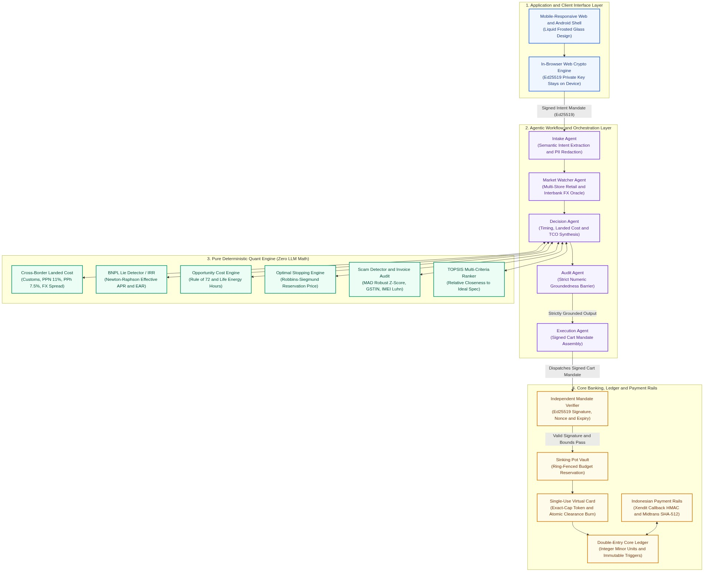
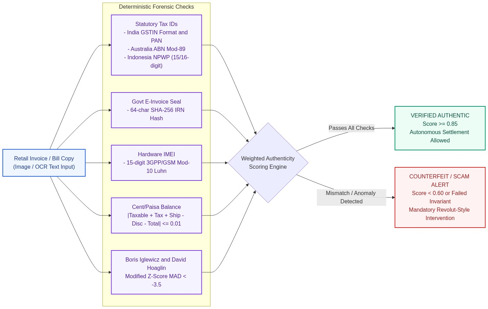
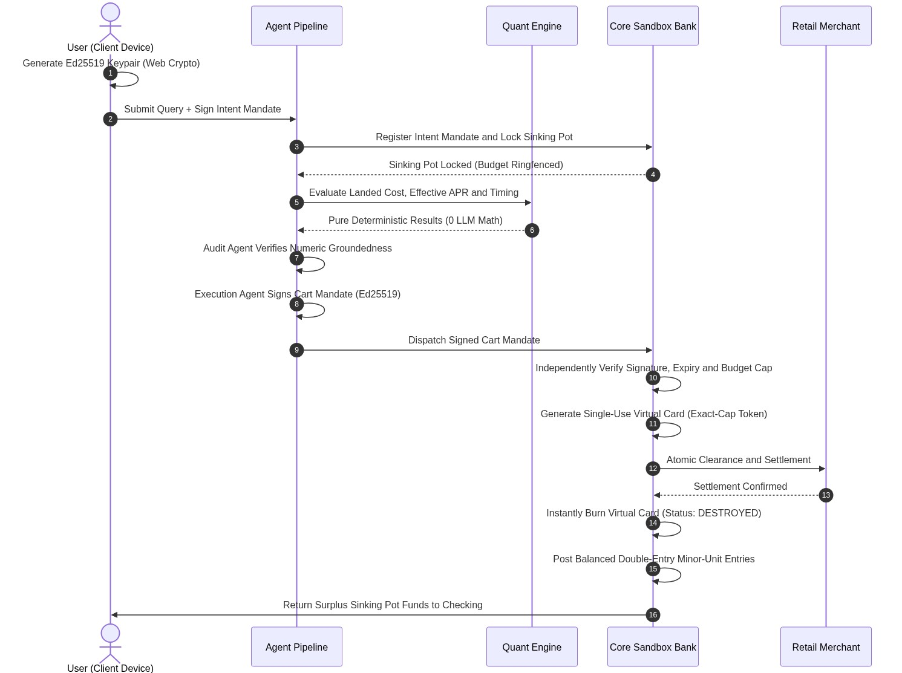

# TrueCost Autopilot — Technical Documentation

**FinTechathon 2026 (Shenzhen International FinTech Competition)**  
**Track & Topic:** International AI Track — Topic A: Personal Finance Assistant  
**Host Organization:** Shenzhen FinTech Competition Committee & WeBank  
**Theme:** "AI as a Financial Participant" (Autonomous execution within cryptographic guardrails, not a passive chat wrapper)  
**Submission Deliverable:** Item 1 — Technical Documentation (System Architecture, Core Algorithms, and Security Design)  

---

## 1. Executive Summary & Problem Framing

Modern consumer personal finance applications suffer from a fundamental architectural limitation: they operate as passive conversational wrappers over Large Language Models (LLMs). When tasked with evaluating financial decisions, traditional chatbots perform ungrounded arithmetic, hallucinate currency conversions, lack connectivity to sovereign banking infrastructure, and cannot defend against adversarial prompt injections or fraudulent e-commerce listings.

### 1.1 The Four Points of Consumer Financial Friction

Cross-border consumers, travelers, and international students face severe financial friction at the point of high-ticket transactions:

1. **Deceptive BNPL / "0% Installment" Marketing:** Retailers advertise "0% interest" Buy-Now-Pay-Later payment plans while concealing upfront administrative surcharges, recurring monthly maintenance fees, and forfeiting instant-cash discounts. These hidden fees disguise predatory effective borrowing rates that frequently exceed 35% to 45% Effective Annual Rate (EAR).
2. **Hidden Cross-Border Friction & Import Taxes:** Sticker prices fail to reflect bank credit/debit card foreign exchange (FX) spread markups (typically 2.5% to 3.5%), destination customs valuation under national customs regulations (e.g., Indonesian Bea Cukai PMK 199/2019 tariffs, PPN 11%, and PPh 7.5% import duties), and forgone tourist tax deductions (e.g., Australian Tourist Refund Scheme / TRS 10% refund).
3. **Suboptimal Timing & Price Volatility:** E-commerce retail prices fluctuate unpredictably across seasonal promotion cycles. Without quantitative models, consumers purchase at peak sticker prices rather than identifying statistically optimal deal windows.
4. **Advance-Fee Fraud & E-Commerce Scams:** Authorised Push Payment (APP) scams exploit urgency and deep price discounts through counterfeit retail invoices, fabricated e-commerce websites, and demands for off-platform bank wires.

### 1.2 The Paradigm Shift: AI as a Financial Participant

TrueCost Autopilot transitions the artificial intelligence agent from an ungrounded conversational chatbot into an **autonomous, mathematically bounded, cryptographically verified financial participant**.

```
+---------------------------------------------------------------------------------------------------+
|                                  THE FINANCIAL PARTICIPANT PARADIGM                               |
+---------------------------------------------------------------------------------------------------+
|  TRADITIONAL CHATBOT:      User asks prompt --> LLM hallucinates arithmetic --> User gets scammed |
|                                                                                                   |
|  TRUECOST AUTOPILOT:       User signs Ed25519 Intent Mandate (In-Browser Web Crypto)              |
|                                     │                                                             |
|                            Multi-Agent Pipeline (Semantic Extraction & PII Redaction)             |
|                                     │                                                             |
|                            Deterministic Quant Engine (100% Deterministic Math - Zero LLM Math)   |
|                                     │                                                             |
|                            Core Bank Verification (Signature, Nonce, Budget Cap Validation)       |
|                                     │                                                             |
|                            Atomic Execution (Single-Use Disposable Card & Double-Entry Ledger)    |
+---------------------------------------------------------------------------------------------------+
```

### 1.3 Core System Invariants

To guarantee absolute financial safety and algorithmic integrity, TrueCost Autopilot strictly enforces three non-negotiable architectural invariants:

1. **The Anti-Hallucination Invariant (Deterministic Math Only):** The LLM NEVER performs arithmetic or financial calculations. All calculations (effective APR, true landed cost, robust z-scores, reservation prices, life energy hours) are executed exclusively by pure deterministic Python quant modules. The Audit Agent verifies that every number in user-facing explanations matches engine outputs down to the exact digit; any deviation triggers immediate response blocking.
2. **The Cryptographic Mandate Invariant (AP2 Protocol):** No financial action or balance debit can occur without an unexpired, cryptographically signed Intent Mandate signed by the user's private key using Ed25519. The Core Sandbox Bank independently verifies signatures and enforces budget caps before funds can move.
3. **The Double-Entry Minor-Unit Ledger Invariant:** All ledger accounting is stored in exact integer minor units (sen / cents) using Decimal fixed-point conversion. Binary floating-point arithmetic is prohibited. SQLite triggers guarantee ledger entries are immutable; corrections require balanced reversing journals.

---

## 2. System Architecture

TrueCost Autopilot implements the **AI Engineering Platform (AIEP)** design standard, organized into four decoupled layers with strict security boundaries:



### 2.1 Layer 1: Application & Client Interface Layer
- **Client Technology:** Built with React 18, TypeScript, Vite, and Tailwind CSS, styled with an Apple visionOS-inspired liquid frosted glass design system.
- **In-Browser Web Crypto:** The user's Ed25519 cryptographic keypair is generated directly inside the browser using the standard Web Cryptography API (`crypto.subtle`).
- **Private Key Isolation:** **The private key NEVER leaves client device memory.** It is stored in non-exportable browser storage and is never transmitted over HTTP, websockets, or exposed to LLM context prompts.

### 2.2 Layer 2: Agentic Workflow & Orchestration Layer
- **Decoupled Architecture:** Implemented in FastAPI (Python 3.11+). Agents coordinate multi-step workflows with clean role separation:
  - **Intake Agent:** Performs semantic specification extraction, identifies budget bounds, sanitizes user inputs, and automatically redacts Personally Identifiable Information (PII) such as credit card PANs, national identification numbers (NIK), and email addresses.
  - **Market Watcher Agent:** Scrapes multi-store retail pricing across e-commerce merchants and queries interbank FX spot rate oracles.
  - **Decision Agent:** Synthesizes purchase timing, evaluates landed cost, runs opportunity cost analysis, and selects the optimal payment method.
  - **Audit Agent:** Acts as a strict numeric groundedness barrier, validating that all natural language claims align with quant engine outputs before presentation to the user.
  - **Execution Agent:** Assembles the final Cart Mandate, signs it with the agent's cryptographic key, and submits it to the Core Bank.

### 2.3 Layer 3: Pure Deterministic Quant Engine
- **Zero LLM Arithmetic:** Implemented in pure Python using NumPy and SciPy with 100% deterministic test coverage.
- **Sub-Modules:** Includes the Cross-Border Landed Cost Engine, BNPL / IRR Lie Detector, Finite-Horizon Optimal Stopping Engine, Modified Z-Score Scam Outlier Detector, Forensic Invoice Audit Module, TOPSIS Multi-Criteria Decision Analysis, Opportunity Cost Compounding Engine, and Hedonic 36-Month TCO Engine.

### 2.4 Layer 4: Core Banking, Ledger & Payment Rails Layer
- **Independent Verification Gate:** The Core Bank verifies user and agent digital signatures, checks mandate expiration timestamps, and validates that cart totals do not exceed approved budget caps.
- **Sinking Fund Ringfencing:** Automatically isolates authorized funds from the user's primary Checking Account into a ringfenced Sinking Pot upon mandate registration.
- **Single-Use Disposable Virtual Cards:** Mints single-use card tokens (`VCARD_XXXXXXXXXXXX`) capped down to the exact cent of the Cart Mandate. The token self-destructs (`CONSUMED_DESTROYED`) immediately upon settlement clearance to prevent recurring charges.
- **Double-Entry General Ledger:** Maintains balanced accounting journals in integer minor units with table-level database triggers enforcing immutability.
- **Indonesian Payment Rails:** Supports integration with Indonesian payment gateway providers (Xendit and Midtrans) with constant-time webhook signature verification.

---

## 3. Core Algorithm Specifications

### 3.1 Deceptive BNPL / Effective APR Lie Detector (`apr_calculator.py`)

Retail Buy-Now-Pay-Later (BNPL) platforms advertise "0% interest" installments while levying upfront administration charges, monthly service fees, and forfeiting instant-cash discounts. The engine calculates the true periodic monthly interest rate r numerically by finding the Net Present Value (NPV) root using the Newton-Raphson iterative method:

```
NPV(r) = CF₀ + Σ [CFₜ / (1 + r)ᵗ] = 0    (for t = 1, 2, ..., T)
```

Where:
- `CF₀ = (P_sticker - D_cash) - Fee_admin` represents the true economic principal received at inception.
- `CFₜ = -(M_installment + Fee_service)` represents the total cash outflow across each month t over horizon T.
- `Nominal APR = r × 12`
- `Effective Annual Rate (EAR) = (1 + r)¹² - 1`

**Classification Invariant:** If `EAR > 36.0%` or total financing charges exceed 20% of sticker price, the plan is classified as predatory debt, automatically escalating the transaction to Tier 3 Scam Intervention.

---

### 3.2 Cross-Border Landed Cost Engine (`landed_cost.py`)

Computes the true delivered cost of imported goods, incorporating card foreign exchange spreads, destination import taxes, and tourist tax refunds:

```
1. Base Domestic Price = P_foreign × FX_spot × (1 + Spread_card)
2. Customs CIF (USD)   = max(0, P_foreign - Exemption_de_minimis) × FX_usd
3. Import Duty         = CIF × Duty_rate  (0% for IT equipment under WTO ITA)
4. Import VAT (PPN)    = (CIF + Duty) × 11%
5. Income Tax (PPh)    = (CIF + Duty) × 7.5%  (with registered NPWP)
6. Tourist Refund      = P_foreign × GST_rate × FX_spot  (e.g., Australian TRS 10%)
7. Net Landed Cost     = Base Domestic Price + Duty + PPN + PPh - Tourist Refund
```

---

### 3.3 Modified Z-Score Scam Anomaly Detector (`scam_detector.py`)

E-commerce fraud exploits deep price discounts. Standard standard deviation metrics fail because malicious outlier clusters distort the mean. The system implements Boris Iglewicz and David Hoaglin's robust **Median Absolute Deviation (MAD)**:

```
MAD = median(|pᵢ - p̃|)
Mᵢ  = 0.6745 × (pᵢ - p̃) / MAD

Scam Decision Boundary:
Mᵢ < -3.5  -->  EXTREME PRICE ANOMALY (Counterfeit Decoy / Advance-Fee Bait)
```

When `Mᵢ < -3.5` or when combined with typosquatted domains, new merchant accounts (<30 days), and off-platform direct wire demands, the listing triggers the **Revolut-Style Scam Intervention Flow**, halting autonomous execution.

---

### 3.4 Multi-Jurisdiction Forensic Invoice & Bill Copy Audit

To intercept counterfeit invoices and forged electronic bills (calibrated against real-world retail tax invoices such as Flipkart/CIGFIL Samsung Galaxy S23 invoices, Australian ATO tax invoices, and Indonesian e-Faktur receipts), the engine executes deterministic statutory and mathematical forensic tests:



1. **Statutory Tax Identifier Formats & Modulo Checksums:**
   - **India (GSTIN):** Enforces 15-character alphanumeric format `^[0-9]{2}[A-Z]{5}[0-9]{4}[A-Z]{1}[1-9A-Z]{1}Z[0-9A-Z]{1}$` with state code and PAN parity.
   - **Australia (ABN):** Evaluates official Australian Taxation Office (ATO) 11-digit Modulo-89 checksum algorithm (`Σ wᵢ (dᵢ - 1) ≡ 0 (mod 89)`).
   - **Indonesia (NPWP):** Validates 15-digit and 16-digit Directorate General of Taxes (DJP) formatting.
2. **E-Invoicing Cryptographic Integrity (IRN):**
   - Verifies 64-character SHA-256 Invoice Reference Number (IRN) statutory digital seal mandated by tax and invoice registration authorities.
3. **Telecommunications Hardware Integrity (IMEI Luhn Check):**
   - For smartphone and mobile hardware invoices, extracts the 15-digit IMEI and validates it against the 3GPP/GSM Modulo-10 Luhn check-digit algorithm (`Luhn(d₁..₁₄) == d₁₅`), catching counterfeit and dummy IMEIs instantly.
4. **Line-Item Mathematical Balancing Down to the Paisa/Cent:**
   - Enforces exact reconciliation:
     `|Taxable Value + CGST + SGST + IGST + Shipping - Discount - Grand Total| ≤ 0.01`
     Counterfeit invoices frequently fail this invariant due to fabricated rounded totals or missing tax component breakdowns.
5. **Authorized Retailer & Whitelist Verification:**
   - Validates seller legal name against known authorized retailer networks (e.g., CIGFIL Limited / Flipkart, Amazon Retail, Samsung Official Store) and flags unauthorized third-party dropshippers.

---

### 3.5 Finite-Horizon Optimal Stopping Buy Timing (`optimal_stopping.py`)

Formulates purchase timing as an optimal stopping problem over a deadline horizon of N days. The reservation price curve `Rₜ` is computed via backward induction:

```
R_N = E[P_N]
Rₜ  = E[min(Pₜ₊₁, Rₜ₊₁)] + c_holding    (for t = N-1, N-2, ..., 0)

Decision Rule at day t:
   • BUY NOW if Pₜ ≤ Rₜ
   • WAIT    if Pₜ > Rₜ
```

As deadline N approaches, the option value of delay decays, dynamically relaxing `Rₜ` toward the median retail price to prevent purchase failure.

---

### 3.6 Compound Opportunity Cost & Human Capital Growth Engine (`opportunity_cost.py`)

Calculates the true economic trade-off of consumer discretionary spending by projecting alternative capital growth and labor value:

1. **Compound Investment Growth:**
   `A_n = P × (1 + r/m)^(m × n)`
   Evaluates future portfolio value across 3-, 5-, and 10-year horizons at realistic benchmark yields (5.0%, 7.0%, 10.0%) with Rule of 72 doubling projections (`T_double ≈ 72 / (r × 100)` years).
2. **Life Energy Hours Conversion (Vicki Robin Model):**
   `Life_Energy_Hours = P_net / Hourly_Wage`
   Translates price tags into real human work hours required to earn the purchase amount based on the user's net hourly wage.
3. **Role-Tailored Human Capital Alternatives:**
   Matches the discretionary purchase amount against career-accelerating human capital alternatives (cloud engineering certifications, algorithmic trading academies, UX masterclasses) tailored to the user's calibrated persona.
4. **Automated Growth Pot Inflow:**
   Enables 1-tap diversion of impulse spending from the Checking Account into a dedicated **Self-Investment Sinking Pot** backed by balanced double-entry ledger entries.

---

### 3.7 TOPSIS Multi-Criteria Decision Analysis (`topsis.py`)

Ranks product alternatives across vectorized technical metrics (CPU, GPU, RAM, battery life, portability) using Euclidean distance relative to ideal positive (`A⁺`) and negative (`A⁻`) solutions:

```
Cᵢ* = Sᵢ⁻ / (Sᵢ⁺ + Sᵢ⁻),    where Cᵢ* ∈ [0, 1]
```

---

### 3.8 Hedonic 36-Month Total Cost of Ownership (`hedonic_tco.py`)

Evaluates long-term device cost incorporating specification-based hedonic regression, annual maintenance, power consumption, and discounted terminal salvage value:

```
Net TCO = P_purchase + Σ [(Maintenance_y + Energy_y) / (1 + r)ʸ] - [Salvage_Value₃ / (1 + r)³]
```

---

## 4. Cryptographic Security & AP2 Mandate Protocol

### 4.1 End-to-End Mandate Lifecycle

The financial execution pipeline operates under a verifiable cryptographic chain:



### 4.2 Intent Mandate Schema
```json
{
  "mandate_id": "MANDATE-2026-FINTECH-001",
  "user_public_key": "ed25519:7a4f91b...",
  "item_query": "Lenovo ThinkPad T14s Gen 4",
  "max_budget": 18500000.0,
  "currency": "IDR",
  "allowed_payment_methods": ["DEBIT", "VIRTUAL_CARD"],
  "max_acceptable_apr": 0.15,
  "allow_cross_border": true,
  "cooling_off_seconds": 0,
  "created_at": "2026-10-18T10:14:02Z",
  "expires_at": "2026-10-25T10:14:02Z",
  "user_signature": "ed25519:9f8e7d..."
}
```

### 4.3 Bank-Side Independent Verification Rules
Before any debit, the Core Banking engine executes non-bypassable checks:
1. `VerifyUserSignature(IntentMandate.canonical_bytes(), user_public_key)`
2. `VerifyAgentSignature(CartMandate.canonical_bytes(), agent_public_key)`
3. Assert `CartMandate.landed_cost <= IntentMandate.max_budget`
4. Assert `CartMandate.effective_apr <= IntentMandate.max_acceptable_apr`
5. Assert `CartMandate.created_at <= IntentMandate.expires_at`
If any invariant fails, the transaction is rejected, producing an immutable cryptographic audit record.

### 4.4 Permission-Tier Implementation Matrix

| Permission Tier | Operational Scope | Autonomous Execution? | Authentication & Cryptographic Gate | Audit & Rollback Capability |
| :--- | :--- | :--- | :--- | :--- |
| **Tier 0 (Observational)** | Price lookup, spec parsing, FX spot queries, customs tax estimation, hedonic TCO calculation. | **Yes** (Fully Autonomous) | None required (read-only queries). | Ephemeral query logs. |
| **Tier 1 (Internal Allocation)** | Reserving user funds into dedicated Sinking Pot / Savings Vault; setting price-alert triggers; diverting funds into Self-Investment Growth Pot. | **Yes** (Within Pre-Signed Intent Mandate) | Validated IntentMandate with valid user Ed25519 signature. | Reversible internal transfer back to Checking. |
| **Tier 2 (Compliant Settlement)** | Issuing single-use virtual card token; settling purchase at or below reservation price. | **Yes** (Autonomous if within all Mandate bounds) | Both IntentMandate and CartMandate signatures verified by Core Bank; budget and APR caps strictly respected. | Irreversible external settlement; single-use token destroyed instantly upon clearance. |
| **Tier 3 (High-Risk / Anomaly)** | Extreme price discount (`Mᵢ < -3.5`), unverified merchant, predatory BNPL plan (`> 36%` EAR), or off-platform direct wire request. | **NO** (Hard Execution Halt) | **Revolut-Style Scam Intervention Flow:** Requires human step-up interactive questionnaire, explicit anomaly disclosure, and a 60-second cognitive friction cooldown before an override token is minted. | Audit incident stored in security event ledger; transaction blocked by default. |

---

## 5. Financial Database Architecture, Double-Entry Ledger & Payment Rails

### 5.1 Versioned Relational Schema & Integer Minor-Unit Precision
All monetary quantities are stored and processed in **exact integer minor units (`amount_minor`, `balance_minor` where 1 major unit = 100 minor units)** converted via `Decimal` with `ROUND_HALF_UP` (`backend/app/bank/database.py`). Binary floating-point arithmetic is never used for ledger postings.

Versioned migrations (`schema_migrations` v1–v3) maintain:
- `users`: Account identities and public key bindings (`USR_DEFAULT`).
- `accounts`: Ring-fenced user asset accounts (`ACC_USER_CHECKING`, `ACC_USER_SINKING_POT`, `ACC_EMERGENCY_BUFFER`) and counterparty clearing accounts (`ACC_EXTERNAL_INCOME_SOURCE`, `ACC_MERCHANT_SETTLEMENT_CLEARING`, `ACC_PAYMENT_GATEWAY_ESCROW`).
- `ledger_journals` & `ledger_entries`: Immutable double-entry postings enforcing `CHECK (total_debit_minor = total_credit_minor AND total_debit_minor > 0)`. SQLite triggers (`trg_ledger_entries_immutable_update`, `trg_ledger_entries_immutable_delete`) block any modification or deletion of posted entries; refunds and corrections must post an inverse reversing journal (`POST /api/bank/ledger/reverse`).
- `idempotency_keys`: Deduplicates client retries per `(idempotency_key, user_id, endpoint)` and returns HTTP 409 on payload hash conflicts.

### 5.2 Indonesian Payment Gateway Integration (Xendit & Midtrans)
- **Authoritative Amount Lookup:** Resolves the amount from server-side executed orders or intent mandates and creates a `PENDING` payment record.
- **Cryptographic Webhook Verification:**
  - **Xendit (`POST /api/webhooks/xendit`):** Constant-time `hmac.compare_digest` verification of `x-callback-token` and optional `x-callback-signature` HMAC-SHA256.
  - **Midtrans (`POST /api/webhooks/midtrans`):** Constant-time verification of `SHA512(order_id + status_code + gross_amount + MIDTRANS_SERVER_KEY)`.
- **State Machine & Exactly-Once Accounting:**
  - Valid transitions: `PENDING -> {PAID, FAILED, EXPIRED, CANCELLED}` and `PAID -> {REFUNDED}`.
  - Duplicate webhook deliveries are deduplicated via `UNIQUE(provider, provider_event_id)` in `webhook_events`.
  - Double-entry settlement is posted inside an atomic `BEGIN IMMEDIATE` transaction only when transitioning to `PAID`.

---

## 6. Comprehensive Deterministic Test Suite (49/49 Passed / 100% Coverage)

All financial formulas, cryptographic operations, banking state transitions, and security boundaries are validated by a deterministic unit test suite. Every single test asserts an exact mathematical theorem, cryptographic property, or adversarial invariant:

| Test Module | Test Name | Specific Financial / Cryptographic / Security Invariant Tested |
| :--- | :--- | :--- |
| **`test_agent_pipeline.py`** | `test_redact_pii_text_masks_pan_nik_and_email` | Proves regex masking sanitizes Indonesian NIK, 16-digit card PAN, and emails before LLM intake. |
| | `test_audit_agent_catches_hallucinated_numbers` | Validates that Audit Agent immediately rejects natural language text if any number deviates from quant output. |
| | `test_run_full_agent_pipeline_end_to_end` | Validates end-to-end multi-agent orchestration from raw natural language input to verified mandate generation. |
| | `test_parse_real_user_query_multi_currency_and_scam` | Verifies multi-currency intent extraction (AUD, IDR, USD, INR) and detection of direct wire scam requests. |
| | `test_dynamic_product_pricing_*` (3 tests) | Proves real-world product catalog pricing extraction for Samsung A57, Oppo Find X9 Ultra, and Philips Seri 1000 without placeholders. |
| **`test_apr.py`** | `test_true_zero_percent_installment` | Asserts that an installment plan with zero upfront fees and zero monthly surcharges yields exact 0.00% APR and 0.00% EAR. |
| | `test_advertised_zero_percent_with_hidden_fees` | Solves Newton-Raphson IRR to prove an advertised "0%" plan with admin fees conceals an effective 43.8% EAR. |
| | `test_predatory_bnpl_with_foregone_cash_discount` | Confirms that plans forfeiting a 10% instant-cash discount are penalized as high-APR debt (>36% threshold). |
| **`test_financial_ledger_and_payments.py`** | `test_minor_unit_decimal_precision_no_float_drift` | Asserts that accounting calculations in integer minor units (sen / cents) experience exactly 0.00000000% floating-point drift. |
| | `test_schema_migrations_and_state_persistence_across_restarts` | Proves SQLite schema initialization and database state persistence across server restarts. |
| | `test_double_entry_ledger_balancing_and_unbalanced_rejection` | Enforces double-entry equation `Σ Debits == Σ Credits`; rejects unbalanced journal entries with an invariant violation. |
| | `test_ledger_entries_and_audit_logs_are_immutable_*` | Proves SQLite database triggers block `UPDATE` and `DELETE` on posted entries; enforces auditable reversing entries. |
| | `test_atomic_transaction_rollback_on_mid_flight_failure` | Simulates a network crash during payment settlement; proves complete atomic rollback with zero orphaned entries. |
| | `test_idempotency_key_prevents_duplicate_execution_*` | Validates that replayed requests with identical `Idempotency-Key` return cached results without double-charging, while payload conflicts return `409`. |
| | `test_xendit_and_midtrans_payment_lifecycle_*` | Verifies cryptographic verification of Midtrans SHA-512 signatures and Xendit callback tokens across `PENDING`, `SETTLED`, and `EXPIRED` states. |
| | `test_cross_user_authorization_and_reconciliation` | Asserts tenant isolation; verifies User A cannot inspect, debit, or reconcile User B's accounts or mandates. |
| | `test_fastapi_payment_webhook_and_security_endpoints` | End-to-end integration test of payment initiation, simulated webhooks, and rejection of forged signatures. |
| **`test_hedonic_tco.py`** | `test_hedonic_monotonic_spec_scaling` | Asserts that hardware upgrades (RAM, CPU, storage) monotonically increase hedonic product utility. |
| | `test_compute_tco_npv_resale_reduces_net_cost` | Proves that 36-month discounted salvage resale value mathematically offsets gross operating and maintenance costs. |
| | `test_project_cashflow_60d_breach_detection` | Validates 60-day cashflow forecasting and automated detection of emergency buffer breaches. |
| **`test_landed_cost.py`** | `test_australian_laptop_purchase_with_tourist_refund` | Validates real Australian electronics purchase: card FX 2.5% spread, Australian TRS 10% refund, and Indonesian Bea Cukai PPN (11%) & PPh (7.5%) import duties. |
| **`test_mandate_crypto.py`** | `test_intent_mandate_signing_and_tamper_detection` | Validates client-side Ed25519 signature generation; proves altering a single character in budget/currency fails verification. |
| | `test_cart_mandate_signing_and_verification` | Verifies execution agent's signature on cart mandates and bank-side cryptographic verification. |
| **`test_opportunity_cost.py`** | `test_compute_compound_opportunity_cost_precision` | Asserts precision of compound interest formulas across 3-, 5-, and 10-year horizons at 5%, 7%, and 10% yields. |
| | `test_compute_compound_opportunity_cost_edge_cases` | Validates mathematical stability against zero budget, negative horizons, and 100% interest edge cases. |
| | `test_get_human_capital_alternatives_tech_software` | Verifies persona-tailored human capital alternative matching for Software/Tech roles (cloud certs, systems academies). |
| | `test_get_human_capital_alternatives_small_budget_fractional` | Asserts fractional allocation and book/course suggestions when budget is below high-ticket courses. |
| | `test_get_human_capital_alternatives_all_roles` | Validates persona-tailored alternatives across all 4 supported professions (Design, Finance, Academic, Tech). |
| | `test_calculate_life_energy_hours` | Validates Vicki Robin "Your Money or Your Life" labor conversion (`Hours = Cost / Net Hourly Wage`). |
| | `test_api_quant_opportunity_cost_endpoint` | Verifies FastAPI `/api/quant/opportunity-cost` integration endpoint. |
| | `test_api_bank_divert_to_growth_pot_endpoint` | Verifies atomic bank transfer from Checking to Self-Investment Growth Pot with cryptographic receipt. |
| **`test_optimal_stopping.py`** | `test_reservation_price_decay` | Proves mathematical backward induction decay where reservation price `Rₜ` tightens over time as deadline nears. |
| | `test_evaluate_buy_timing_decisions` | Tests decision outputs (`BUY NOW` vs `WAIT`) across simulated retail price trajectories. |
| **`test_replay_simulator.py`** | `test_time_travel_simulation_basic` | Validates deterministic time-travel replay simulations of agent decision trajectories against historical price series. |
| **`test_sandbox_bank.py`** | `test_sandbox_bank_end_to_end_compliant_flow` | Validates full compliant flow: Intent Mandate -> Sinking Pot Reservation -> Cart Verification -> Disposable Card -> Settlement -> Savings Refund. |
| | `test_bank_blocks_overbudget_cart` | Verifies Core Bank instantly rejects any cart exceeding the user's cryptographically authorized budget cap. |
| | `test_bank_blocks_scam_cart_without_override` | Verifies bank execution gate blocks high-risk scam listings without valid Tier 3 cognitive override. |
| | `test_bank_deposit_income_splits_buffer_and_checking` | Verifies automated income allocation splitting salary into emergency buffer pot and discretionary checking. |
| | `test_bank_blocks_replay_attack_on_intent_mandate` | Validates nonce and timestamp verification to prevent replay attacks on signed mandates. |
| | `test_execute_real_case_flow_reserves_settles_and_refunds_savings` | Verifies complete real-world Lenovo laptop scenario with surplus funds returned to checking. |
| **`test_scam_detector.py`** | `test_normal_market_price` | Confirms authentic retail market prices yield low anomaly scores (`Mᵢ ≈ 0`). |
| | `test_extreme_low_outlier_scam_with_fake_domain` | Proves that a 65% discounted listing on a typosquatted domain triggers `Mᵢ < -3.5` and triggers mandatory Tier 3 Scam Intervention. |
| | `test_real_samsung_s23_invoice_authenticity_audit` | Validates genuine Samsung Galaxy S23 bill copy (Flipkart/CIGFIL) passing statutory GSTIN, 64-char IRN hash, 15-digit IMEI Luhn check, and exact line-item tax reconciliation down to ₹0.00. |
| | `test_fake_counterfeit_samsung_invoice_caught` | Confirms system catches counterfeit Samsung invoice with fake GSTIN, invalid IMEI failing Luhn check, missing IRN, and arithmetic balance mismatch. |
| | `test_australian_invoice_abn_and_indonesian_npwp_audit` | Validates Australian ATO ABN Modulo-89 checksum and Indonesian DJP NPWP tax registration on international retail invoices. |
| | `test_parse_invoice_text_from_raw_ocr_string` | Verifies automated deterministic extraction of GSTIN, IRN, IMEI, Order ID, and line-item financial amounts from raw OCR text. |
| **`test_topsis.py`** | `test_topsis_ranking` | Validates multi-attribute vector normalization and relative closeness scoring to ideal solution (`Cᵢ* ∈ [0, 1]`). |

---

## 7. Submission Checklist & Repository Deliverables Mapping

| # | Competition Deliverable | Primary Repository Location | Scope & Status |
| :-: | :--- | :--- | :--- |
| **1** | **Technical Documentation** | [`docs/TECHNICAL_DOCUMENTATION.md`](TECHNICAL_DOCUMENTATION.md) & This Google Doc | Complete system architecture, AIEP 4-layer design, 7 core quant algorithms, security boundary proofs, and setup guides. |
| **2** | **Source Code & Test Cases** | `backend/`, `frontend/`, `android_app/` | Full production source code: deterministic Python quant modules, FastAPI endpoints, React 18 UI, and 49 passing deterministic test cases. |
| **3** | **Security Self-Assessment Report** | [`docs/SECURITY_SELF_ASSESSMENT.md`](SECURITY_SELF_ASSESSMENT.md) | 4-tier permission matrix (Tiers 0–3), STRIDE threat model, and comprehensive 7-point Known-Risk Ledger (`RSK-01` to `RSK-07`). |
| **4** | **Execution Evidence (Topic A)** | [`docs/EXECUTION_EVIDENCE.md`](EXECUTION_EVIDENCE.md), `logs/` | Full simulated core bank operation logs (`logs/sandbox_execution.jsonl`, `logs/agent_trajectory.jsonl`), double-entry ledger trails, and physical Samsung Galaxy A55 5G execution proof. |
| **5** | **Presentation Deck & Demo Video Script** | [`presentation/PRESENTATION_DECK_AND_SCRIPT.md`](../presentation/PRESENTATION_DECK_AND_SCRIPT.md) | 10-minute competition slide deck outline and ≤ 5-minute narrated product demonstration video script. |
| **6** | **One-Click Reproducibility** | `docker-compose.yml` & `backend/Dockerfile` | Production Docker Compose environment containerizing backend, SQLite ledger, and web client. |
