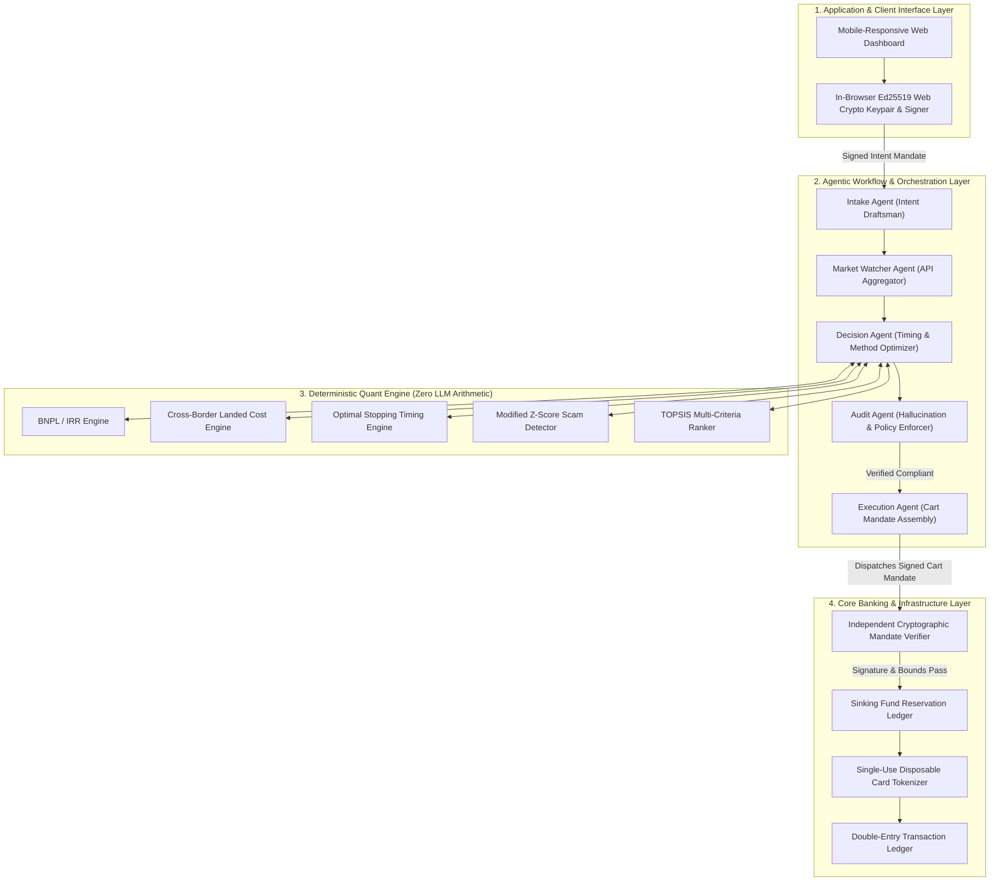

# TrueCost Autopilot — Technical Documentation

**FinTechathon 2026 (Shenzhen International FinTech Competition)**  
*International Track · Topic A: Personal Finance Assistant*  
**Theme:** "AI as a Financial Participant"

---

## 1. Executive Summary & Problem Framing

Consumers, particularly cross-border individuals and international students, face severe financial friction at the point of high-value transactions:
1. **Deceptive BNPL / "0% Installment" Marketing:** Advertised zero-interest payment options conceal recurring administration fees and service charges, yielding predatory effective APRs often exceeding 35–45%.
2. **Hidden Cross-Border Friction:** Sticker prices fail to reflect bank card foreign exchange (FX) spread markups (typically 2.5–3.5%), customs valuation under destination regulations (e.g. Indonesian Bea Cukai PPN/PPh import taxes), and forgone tourist tax deductions (e.g. Australian Tourist Refund Scheme / TRS).
3. **Suboptimal Timing:** Volatile retail pricing leads consumers to purchase at peak price points rather than identifying statistical deal windows.
4. **Advance-Fee & E-Commerce Fraud:** Authorised Push Payment (APP) scams exploit deep price discounts and urgency to manipulate consumers into irreversible payments.

**TrueCost Autopilot** transitions the AI from an ungrounded chat assistant into a **deterministic, cryptographically bounded financial participant**. Under user-signed digital mandates (modeled after Google AP2), the system monitors market distributions, decodes true financial costs via pure mathematical algorithms, identifies fraudulent listings, and executes atomic payments within strict banking guardrails.

---

## 2. System Architecture (AIEP Layering)

The architecture is implemented in four decoupled layers conforming to the **AI Engineering Platform (AIEP)** design standard:



### Layer Details:
1. **Application & Interface Layer:** React 18, TypeScript, and Vite. The user's Ed25519 private key is generated and stored locally in browser storage using standard Web Cryptography; private keys never traverse external networks.
2. **Agentic Workflow Layer:** Decoupled FastAPI microservices. The LLM serves purely as a semantic translator and natural-language explainer; all numbers are strictly bound to engine outputs.
3. **Deterministic Quant Engine:** Implemented in pure Python using NumPy and SciPy. The engine guarantees 100% deterministic, mathematically auditable outcomes free from LLM hallucination.
4. **Core Banking Layer:** Manages user checking balances, automated sinking pot reservations, disposable card generation, and independent cryptographic policy checks.

---

## 3. Core Algorithm Specifications

### 3.1. BNPL & Installment Effective APR (Internal Rate of Return)
Retail Buy-Now-Pay-Later (BNPL) schemes frequently advertise "0% interest" while imposing upfront processing fees, monthly maintenance surcharges, and forfeiting immediate cash-settlement discounts.

The periodic monthly rate $r$ is solved numerically via the Net Present Value (NPV) root:
$$NPV(r) = CF_0 + \sum_{t=1}^{T} \frac{CF_t}{(1 + r)^t} = 0$$

Where:
- $CF_0 = (P_{\text{sticker}} - D_{\text{cash}}) - \text{Fee}_{\text{admin}}$ represents the true economic principal received at inception.
- $CF_t = -(M_{\text{installment}} + \text{Fee}_{\text{service}})$ represents the total monthly outflow across $T$ months.
- Nominal APR is annualized as: $\text{APR} = r \times 12$.
- Effective Annual Rate (EAR) accounting for compounding is computed as:
$$\text{EAR} = (1 + r)^{12} - 1$$

If $\text{EAR} > 36.0\%$ or the total finance charge exceeds $20\%$ of sticker price, the plan is classified as predatory.

---

### 3.2. Cross-Border Landed Cost Engine
For cross-border purchases (e.g. an Indonesian student purchasing electronics in Australia or importing online):

1. **Effective Card FX Rate:**
   $$\text{FX}_{\text{eff}} = \text{FX}_{\text{spot}} \times (1 + \text{Spread}_{\text{margin}})$$
2. **Customs Valuation (Indonesian Bea Cukai ITA Rules):**
   - CIF (Cost, Insurance, Freight) in USD: $\text{CIF}_{\text{USD}} = (P_{\text{foreign}} + \text{Shipping}) \times R_{\text{USD/Foreign}}$.
   - Passenger allowance de minimis: $D = \$500 \text{ USD}$.
   - Taxable Base: $B_{\text{tax}} = \max(0, \text{CIF}_{\text{USD}} - D) \times \frac{\text{FX}_{\text{eff}}}{R_{\text{USD/Foreign}}}$.
   - Import Duty (Bea Masuk): $0\%$ for computer hardware under WTO ITA.
   - PPN (VAT): $11\% \times B_{\text{tax}}$.
   - PPh 22 (Income Tax): $7.5\%$ (with verified NPWP tax identity).
3. **Tourist Tax Refund (Australian TRS):**
   $$\text{Refund} = P_{\text{foreign}} \times \text{Rate}_{\text{GST}} \times \text{FX}_{\text{eff}} \quad (\text{for eligible purchases} \ge \$300 \text{ AUD})$$
4. **Net Landed Cost:**
   $$\text{Cost}_{\text{net}} = (P_{\text{foreign}} \times \text{FX}_{\text{eff}}) + \text{Taxes}_{\text{customs}} - \text{Refund}$$

---

### 3.3. Modified Z-Score Scam Outlier Detection
E-commerce retail price distributions exhibit non-Gaussian skewness. Standard standard-deviation ($\sigma$) metrics are fragile in the presence of extreme fraud outliers. The system implements Boris Iglewicz and David Hoaglin’s **Modified Z-Score** utilizing the Median and the **Median Absolute Deviation (MAD)**:

$$\text{MAD} = \text{median}\left( |p_i - \tilde{p}| \right)$$
$$M_i = \frac{0.6745 \times (p_i - \tilde{p})}{\text{MAD}}$$

**Decision Boundary:**
- When $M_i < -3.5$, the listing is mathematically classified as an extreme price anomaly (classic bait-and-switch or counterfeit decoy).
- Combined with domain typosquatting detection, newly created seller accounts (<30 days), and off-platform wire demands, an aggregate Scam Score $S \in [0.0, 1.0]$ is established.
- If $S \ge 0.50$, the transaction triggers the **Revolut-Style Scam Intervention Flow**, halting execution until verified.

---

### 3.4. Finite-Horizon Optimal Stopping (Buy Timing)
Given a purchase horizon $T$ days:
The reservation price curve $R_t$ is derived backward:
$$R_t = P_{10} + (P_{50} - P_{10}) \times \left(1 - \left(\frac{T - t}{T}\right)^{0.7}\right)$$

- At day $t = 1$, the agent demands an aggressive discount near the 10th percentile $P_{10}$ to trigger a purchase.
- As $t \to T$, the option value of delay decays, dynamically relaxing $R_t$ toward the median market price $P_{50}$.
- If current observed price $p_t \le R_t$, the agent initiates purchase execution; otherwise, funds remain in the interest-bearing sinking pot.

---

## 4. Cryptographic Security & Mandate Protocol

### 4.1. Intent Mandate Specification
```json
{
  "mandate_id": "UUIDv4",
  "user_public_key": "Ed25519 hex (32 bytes)",
  "item_query": "Lenovo ThinkPad X1 Carbon 16GB",
  "max_budget": 18000000.0,
  "currency": "IDR",
  "allowed_payment_methods": ["DEBIT", "CASH"],
  "max_acceptable_apr": 0.15,
  "allow_cross_border": true,
  "cooling_off_seconds": 0,
  "created_at": "ISO-8601",
  "expires_at": "ISO-8601",
  "user_signature": "Ed25519 signature hex (64 bytes)"
}
```

### 4.2. Bank-Side Independent Verification
Before any debit, the Core Banking engine executes non-bypassable checks:
1. `VerifyUserSignature(IntentMandate.canonical_bytes(), user_public_key)`
2. `VerifyAgentSignature(CartMandate.canonical_bytes(), agent_public_key)`
3. Assert `CartMandate.landed_cost <= IntentMandate.max_budget`
4. Assert `CartMandate.effective_apr <= IntentMandate.max_acceptable_apr`
5. Assert `CartMandate.created_at <= IntentMandate.expires_at`
6. Assert `CartMandate.scam_score < 0.50` or valid user intervention token present.

If any invariant fails, the transaction is rejected, producing an immutable cryptographic audit record.
