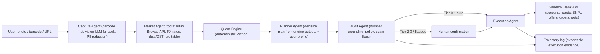

# TrueCost — the Pre-Purchase Financial Agent

*FinTechathon 2026 · International Track · Topic A (Personal Finance Assistant)*

## Problem Statement
How might we give people — starting with international students making big purchases across borders — an AI agent that, at the moment before they pay, works out the **true cost** of a purchase (price fairness, payment-method APR, total cost of ownership, cross-border landed cost, scam risk, budget impact) and then **executes the best financial action** safely, with every number verifiable?

## Recommended Direction
TrueCost reframes "price comparison" as a **financial decision**. The user snaps a shelf price tag / barcode (offline) or pastes a listing URL (online). A multi-agent pipeline identifies the product, gathers comparable offers across sellers and countries, and hands everything to a **deterministic quant engine** — the LLM never does arithmetic. The engine answers five questions: *Is this price fair? Is the discount real? Should I wait? How should I pay? Can I afford it?* — plus *Is this listing a scam?*, using the same statistical machinery (an implausibly low price is itself a fraud signal).

The agent is a **financial participant**, not an advisor: in a sandbox bank it executes the chosen action — pay with the optimal method, decline a deceptive "0%" installment, place a *buy-if-price-below-X* order, or open a sinking-fund pot and schedule transfers. Actions are permission-tiered, high-value or flagged actions require human confirmation, and every step lands in an auditable trajectory log. This hits all three scoring pillars: real task execution (40%), a security story built in from day one (30%), and a novel combination of hedonic pricing + APR/TCO math + cross-border landed cost (30%).

The pitch to WeBank judges is **responsible consumer finance**: a bank-embeddable agent that improves customer outcomes (fewer bad BNPL decisions, fewer scam losses) — directly relevant to a digital bank that lends to consumers.

### Architecture (AIEP layers)

### Quant engine — the methods
| Question | Method |
|---|---|
| Fair price? | Robust z-score (median/MAD) across offers; percentile in price history |
| Real discount? | Claimed "was" price vs. observed history |
| Buy now or wait? | Empirical P(price drop > k% within N days) from history |
| Compare across all aspects | Hedonic regression (implied price per spec) + TOPSIS with user weights |
| How to pay? | Effective APR via IRR of installment/BNPL cash flows vs. card/cash, incl. fees & cashback |
| True cost? | TCO as NPV: price + energy + consumables + warranty − resale value |
| Cross-border? | Landed cost: price + FX spread + shipping + duty/VAT − tourist tax refund; warranty validity |
| Affordable? | Budget-envelope impact + 60-day cash-flow projection |
| Scam listing? | Low-side outlier + seller/domain signals → risk score with reasons |

## Key Assumptions to Validate
- [ ] **Price data is obtainable legally** (dealbreaker) — get eBay developer keys and run a live Browse API query across EBAY_US/GB/AU **today**; synthetic histories must be clearly labeled as such in UI and docs.
- [ ] **Judges read this as finance, not shopping** (dealbreaker) — test the 30-second pitch on 2 people: do they repeat back "APR / true cost / safe payment" or "price comparison"? Lead with the money decision.
- [ ] **Sandbox execution counts as completing real tasks** — rules explicitly accept simulated-account logs; produce exportable JSON/CSV trajectory logs from the first end-to-end run.
- [ ] **Audit layer eliminates numeric hallucination** — benchmark: % of numbers in explanations not traceable to engine output, with vs. without Audit Agent (target: 0% with).
- [ ] **Barcode→product identification is reliable** — measure on 30 real products; vision fallback accuracy reported separately.
- [ ] **Customs / GST rules are correct** — verify Indonesian import allowances/de minimis and Australian Tourist Refund Scheme thresholds from official government sources before encoding them; cite in docs.

## MVP Scope
**One persona, one category, one end-to-end flow, done deeply.** *Indonesian student in Australia buying a laptop.*

**In:**
- Capture: barcode decode + vision-LLM price-tag OCR (IDR/AUD), URL ingestion
- Market: eBay Browse API (3 marketplaces), ECB/Frankfurter FX, a small duty/GST rule table (ID, AU)
- Quant engine with unit tests for every formula (APR/IRR, TCO/NPV, robust z, TOPSIS, hedonic, landed cost, scam score)
- 5 agents (Capture, Market, Planner, Audit, Execution) with typed tool contracts
- Sandbox bank (FastAPI + SQLite): accounts, card, 2 BNPL offers, orders, savings pots, price-trigger orders, idempotency keys
- Permission tiers 0–3 + HITL confirmation + trajectory log viewer
- Responsive web UI (camera capture works on phone browsers)
- Benchmarks: savings vs. "cheapest sticker price" baseline; hallucination rate ± audit; scam detection P/R; p50/p95 latency and token cost per decision
- Docker compose, README, API spec (OpenAPI), test cases

**Out:** see Not Doing.

**Time-box (deadline Oct 20, 22:59 WIB — target submission 18:00 WIB):**
| Day | Focus |
|---|---|
| Oct 14–15 | Data-source spike, repo + Docker skeleton, sandbox bank schema, LLM provider adapter |
| Oct 16 | Capture + Market agents and tools |
| Oct 17 | Quant engine + unit tests |
| Oct 18 | Planner/Audit/Execution agents, permission tiers, HITL, logs, UI wiring |
| Oct 19 | Benchmarks, security self-assessment, technical doc, end-to-end hardening |
| Oct 20 | Deck (≤10 min), demo video (≤5 min), execution evidence, submit with buffer |

## Not Doing (and Why)
- **Physical counterfeit-banknote scanning** — phone cameras can't see UV/IR/magnetic features; counterfeit datasets are restricted; fits no topic.
- **SME invoice-fraud module** — a different user (business, not consumer); would split a 6-day effort and blur the story.
- **Scraping marketplaces without APIs (Tokopedia, Shopee, Amazon pages)** — ToS/licensing risk directly hurts the 30% compliance score.
- **Real checkout / real payments** — sandbox is explicitly accepted; real money adds risk with zero scoring upside.
- **Every product category** — laptops only; depth beats breadth and hedonic regression needs a coherent spec space.
- **Native mobile app** — responsive web with camera access delivers the same demo.
- **Topic F / on-chain bonus** — max 5 points, pulls Web3 effort away from the core.
- **Training custom ML models** — deterministic stats are faster, explainable, and auditable; no time to train well.

## Open Questions
- **Live demo in mainland China:** Google/OpenAI/Anthropic APIs are generally inaccessible from the mainland. Do we build a provider-agnostic adapter (Gemini for dev; Qwen/DeepSeek as China-reachable fallback) and host the backend somewhere reachable from Shenzhen? Always keep a recorded fallback demo.
- Which commercial LLM is primary (vision quality + cost + latency)?
- Does eBay item-specifics data give enough laptop specs for hedonic regression, or do we need a curated, licensed spec dataset?
- Who owns which agent/layer across the team, and who owns the security self-assessment + docs (they are ~30% of the score)?
