# TrueCost Autopilot — delegate the purchase, keep the control

*FinTechathon 2026 · International Track · Topic A (Personal Finance Assistant) · v2 (refined)*

## Problem Statement
How might we let a person delegate a purchase to an AI agent — *what*, *how much at most*, *by when* — and trust it to save toward it, watch the market, and buy at the right moment in the right way, **without ever exceeding what they cryptographically authorized**?

## Recommended Direction
The bottleneck isn't information; it's **delegation**. People buy at the wrong moment and pay the wrong way because watching prices, decoding "0% installment" offers, and adding up cross-border costs is tedious — the whole team has been burned by exactly this (hidden paylater cost, surprise FX/duty, a scam listing, buying right before a price drop). TrueCost Autopilot does the tedious part *as a participant*: the user states an intent once, signs a **mandate**, and the agent executes inside it.

The mandate is the product's spine and its security story. Modeled on the emerging agent-payments pattern (Google's AP2 Intent/Cart Mandates), the user signs an **Intent Mandate** in the browser (item spec, max true cost, deadline, allowed payment methods, max APR, affordability rules, cooling-off rules). When the agent finds the deal, it builds a **Cart Mandate** referencing the intent. The **sandbox bank independently verifies the signature chain and policy before moving a cent** — so even a fully compromised or hallucinating agent cannot overspend. The LLM never does arithmetic and never holds credentials; a deterministic engine makes the numbers, an audit layer checks every number the LLM says.

The interface collapses to **One Number**: *sticker Rp 15.0M → TrueCost Rp 19.4M*, with an evidence drawer behind it. The pitch to WeBank: a **bank-embeddable, responsible-consumer-finance agent** — it routes customers away from predatory installments and scams while increasing trust in agentic payments.

**Persona:** Indonesian student in Australia, buying a laptop (cross-border: IDR/AUD/USD; offline price-tag photos + online listings).

### Architecture (AIEP layers)

```mermaid
flowchart LR
  U["User intent + photo/URL"] --> IA["Intake Agent: drafts Intent Mandate"]
  IA --> SIGN["User reviews and signs in browser (Ed25519, key never leaves device)"]
  SIGN --> MW["Market Watcher Agent (tools: listings API, price history, FX)"]
  MW --> QE["Quant Engine (deterministic)"]
  QE --> DA["Decision Agent: buy / wait / how to pay + explanation"]
  DA --> AU["Audit and Policy Agent: mandate check, number grounding, scam threshold"]
  AU -->|"inside mandate"| EX["Execution Agent: builds and signs Cart Mandate"]
  AU -->|"edge case or flagged"| H["Human confirmation"]
  H --> EX
  EX --> BANK["Sandbox Bank: re-verifies signature chain and policy, then debits"]
  AU --> LOG["Trajectory log (execution evidence)"]
  BANK --> LOG
```

Data/Infra: Postgres/SQLite, price cache, rule tables · Model Matrix: provider-agnostic LLM adapter (small model for intake, explanations only) · Agentic Workflow: the five agents + typed tools · Application: responsive web app + bank console.

### Quant engine (deterministic, unit-tested)
| Tier | Module | Method |
|---|---|---|
| Must | **Buy or wait** | Optimal stopping with a deadline: reservation price from the empirical price distribution, threshold relaxes as the deadline nears |
| Must | **How to pay** | Effective APR via IRR of each installment/paylater cash flow (incl. fees, cashback) vs. card/cash |
| Must | **Landed cost** | Price + FX spread + shipping + duty/VAT − tourist tax refund, in home currency |
| Must | **Scam score** | Low-side robust z-score (median/MAD) + seller feedback/age + domain signals → reasons list |
| Must | **Policy check** | Cart vs. signed Intent Mandate (cap, deadline, merchant, max APR, cooling-off) |
| Should | Spec match | TOPSIS over candidate listings with user weights |
| Should | Affordability | Budget-envelope + debt-to-income check, aligned with Indonesian paylater rules (POJK 32/2025 — verify) |
| Stretch | TCO | NPV of energy/warranty/resale |

### Benchmarks (also the demo)
**Time-travel replay**: run the agent over historical price series on an accelerated clock.
1. **Timing:** avg true cost paid vs. *buy-immediately* and *buy-at-first-discount* baselines, plus regret vs. perfect hindsight.
2. **Payment method:** true cost vs. *always take the advertised 0% installment*.
3. **Safety red-team:** over-limit carts, expired mandates, scam listings, **prompt injection inside listing descriptions** → % blocked (target 100%; bank-side enforcement makes this structural).
4. **Hallucination:** % of numbers in explanations not traceable to engine output, with vs. without Audit Agent.
5. **Efficiency:** the watch→decide loop is deterministic (zero tokens); LLM calls only at intake and explanation → report tokens and p50/p95 latency per decision.

## Key Assumptions to Validate
- [ ] **Licensed price *history* exists for our category** (dealbreaker) — today: check Keepa API (or similar) coverage, cost, and ToS; fallback: a properly licensed public dataset, clearly labeled.
- [ ] **Live listings via a licensed API** (dealbreaker) — today: eBay developer keys + one Browse API query on EBAY_AU/US with seller feedback fields.
- [ ] **Judges read this as finance, not shopping** — 30-second pitch test on 2 outsiders; they should repeat "mandate / true cost / safe autonomous payment."
- [ ] **Replay is convincing as "real task execution"** — sandbox bank logs + signed mandate chain exported as execution evidence; confirm early in the build.
- [ ] **Signing UX is understandable** — 2 non-technical testers sign a mandate in < 60 s without help.
- [ ] **Regulatory facts are right** — verify POJK 32/2025 paylater provisions, Indonesian import allowances, and Australian Tourist Refund Scheme thresholds from official sources; cite them.

## MVP Scope
**One persona, one category (laptops), one loop: intent → signed mandate → watch → decide → bank-verified purchase → audit trail.**

| Day | Focus |
|---|---|
| Oct 14–15 | Data spikes (price history, listings, FX); repo + Docker; sandbox bank schema; mandate format + Ed25519 sign/verify |
| Oct 16 | Intake + Market Watcher agents; replay clock |
| Oct 17 | Quant engine *Must* modules + unit tests |
| Oct 18 | Decision / Audit / Execution agents; bank-side verification; HITL; trajectory log; One-Number UI |
| Oct 19 | Benchmarks + red-team suite; security self-assessment (permission tiers = mandate scopes); technical doc |
| Oct 20 | Deck (≤10 min), demo video (≤5 min), execution evidence; **submit by 18:00 WIB** (hard deadline 22:59 WIB) |

## Not Doing (and Why)
- **Jastip Verifier** — real but too local for international judges; one slide under "future markets" at most.
- **Hedonic regression** — needs a clean spec dataset we don't have; TOPSIS gives explainable comparison for a fraction of the cost.
- **Claiming AP2 compliance** — we implement an *AP2-inspired* mandate model; claiming conformance invites a question we can't win.
- **Real checkout / real money** — sandbox is explicitly accepted; real payments add risk, zero points.
- **Scraping marketplaces without APIs** — ToS risk lands directly on the 30% compliance score.
- **Multiple categories, native mobile app, custom ML training** — depth over breadth; responsive web + deterministic stats are faster and explainable.
- **Counterfeit banknotes / SME invoice fraud** — different problem, different user.

## Open Questions
- **On-chain bonus outside Topic F?** The rules list "challenge bonus (on-chain exploration) 0–5" under unified scoring. If it applies to Topic A, anchoring mandate hashes on a testnet is ~half a day. → Email info@ican-x.com today.
- **China live demo:** keep the LLM adapter provider-agnostic (Gemini/OpenAI for dev; Qwen/DeepSeek reachable from mainland) and always carry a recorded replay demo.
- Which licensed price-history source, and does it cover the AU marketplace or only US/UK?
- Team ownership: who owns mandate crypto + bank verification, engine, agents, UI, and the security report/docs?
